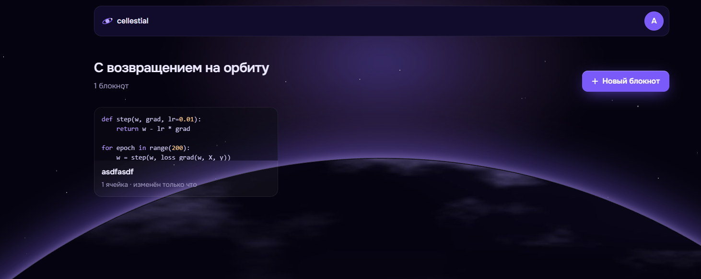

# 2026_2_Cringe_Driven_Development



Frontend проекта «Colab» (Cellestial) команды «Cringe Driven Development».

[](https://cellestial.ru)
[](https://github.com/orgs/Cringe-Driven-Development-Team/projects/1)
[](https://www.figma.com/design/7iaVDGiwzQk2vZIB5ogVlq/Colab)
[](https://docs.cellestial.ru/project-context)
[](https://github.com/go-park-mail-ru/2026_2_Cringe_Driven_Development)

## Быстрый старт

Нужны Bun не ниже 1.4.0 и Node.js не ниже 22.19.0. Команды выполняются из корня репозитория:

```bash
bun install
bun run dev
```

`bun run dev` запускает клиент (Vite) и BFF на одном origin `https://localhost:5173`: HTML страниц
и `/api/trpc` отдаёт BFF, Go для него — Cloud Mock Apidog. При первом запуске mkcert один раз
попросит подтвердить доверие локальному сертификату; в WSL с Chrome в Windows после этого нужен
`bun run dev:trust-windows` — [«Первый запуск»](docs/local-development.md#первый-запуск).
Перед PR выполните `bun run check` и `bun run build`.
Подробности — в [локальной разработке](docs/local-development.md).

## Монорепа

| Каталог | Назначение |
| --- | --- |
| `apps/client` | Vite-клиент |
| `apps/bff` | BFF: Hono + tRPC под Bun, сессия, пользователь в первом HTML; образ и Compose — [docs/local-development.md](docs/local-development.md#bff) |
| `packages/schemas` | zod-схемы операций Go (Orval) |

Зависимости и команды объединены Bun workspaces и Turborepo.

## Документация

- [Локальная разработка и правила кода](docs/local-development.md) — команды, структура, JSDoc.
- [Контракт API в Apidog](docs/api-contract.md) — синхронизация спецификации и генерация типов.
- [CI и выкатка](docs/release.md) — релизы, CD, откат и диагностика.
- [Контекст проекта](https://docs.cellestial.ru/project-context) — общая архитектура и планы.
- [AGENTS.md](AGENTS.md) — локальные правила для агента.

## Как работать с задачами

Задачи команды собраны на общей [доске](https://github.com/orgs/Cringe-Driven-Development-Team/projects/1).
Правила оформления задач и ревью — в
[CONTRIBUTING команды](https://github.com/Cringe-Driven-Development-Team/.github/blob/main/CONTRIBUTING.md).

Формат коммита: `<тип>: <описание>` либо `<тип>(<область>): <описание>`.
Используйте `feat`, `fix`, `refactor`, `style`, `test`, `docs` или `chore`.

Перед коммитом git-хук форматирует то, что уходит в коммит (неиндексированные правки не трогает), и
запускает `bun run check`; при ошибке
коммит не создаётся. Хук ставит `bun install`, поэтому после `git switch` он уже на месте. Если хук
не сработал — `bunx lefthook install`.

## Команда

Ерофей [Гаранин](https://github.com/ManInTheCoat), Денис [Истратов](https://github.com/iRedTea),
Дарья [Шпакова](https://github.com/GrayMouse9), Валентин [Кунев](https://github.com/MrDuckVC).
Менторы: [Ярослав Михалёв](https://github.com/YarikMix) (frontend),
[Александр Батовкин](https://github.com/blackHATred) (backend),
[Дарья Ченцова](https://t.me/dewon_d) (UX).
